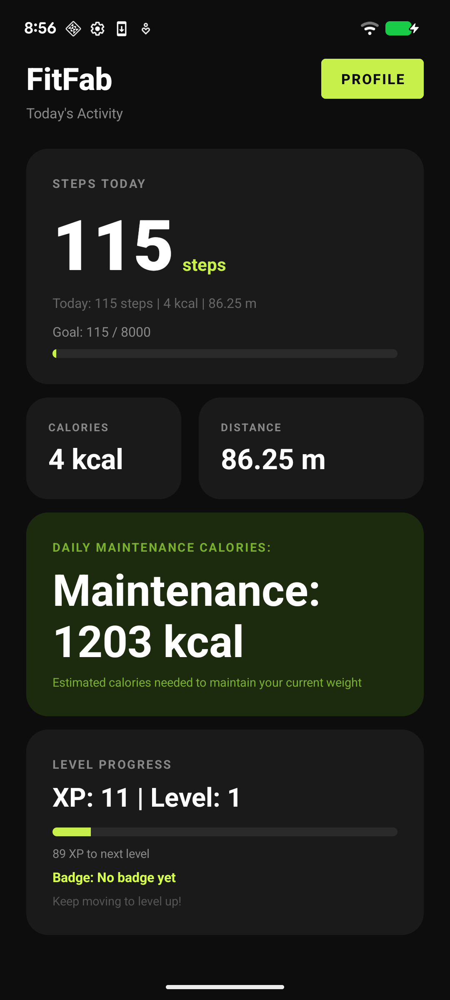
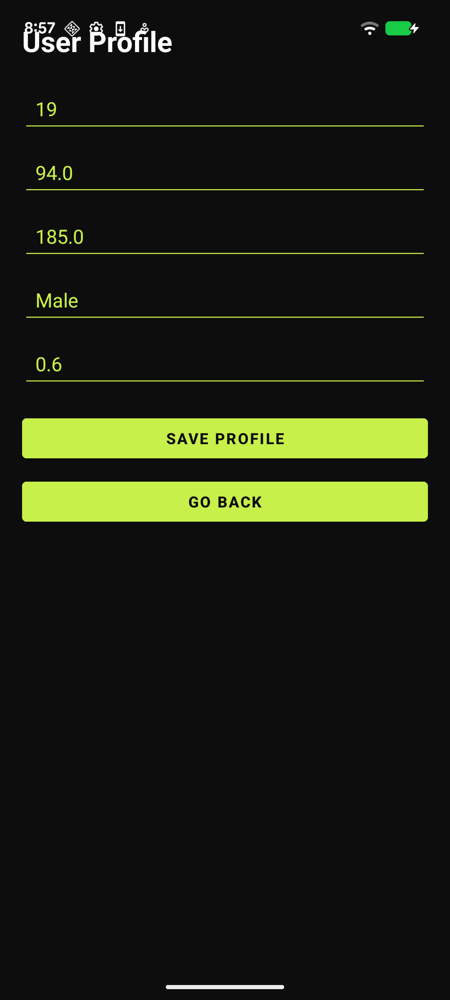

# FitFab

An Android fitness tracker I built for my final year project at Leeds Beckett University (BSc Computer Science, 2:1). It counts steps using the phone's sensors and shows distance, calories, a daily step goal and a simple level system.

## Screenshots

  
  &nbsp;&nbsp;&nbsp;
  

## What it does

- Counts steps using the phone's step sensor
- Shows steps, calories and distance for the day
- Daily step goal with a progress bar
- Works out maintenance calories from your profile (age, weight, height, gender)
- XP, levels and badges
- Saves your profile and data on the phone

## Built with

Kotlin, Android Studio, MVVM, Room (SQLite), SensorManager API

## How it's structured

Activities show the screens, ViewModels hold the logic, and Room stores the data in a local SQLite database.

## Running it

1. Clone the repo: `git clone https://github.com/ismail919/Fitness-Tracker-App.git`
2. Open it in Android Studio and let Gradle sync
3. Run it on an emulator or a real Android phone

Step counting works best on a real phone. On the emulator you can fake sensor data from the extended controls.

## Still to do

- Fix the maintenance calorie calculation
- Unit tests
- GitHub Actions to build and test on every push
- Charts for activity history
- A backend so data can sync between devices

## Author

Muhammad Ismail Khan - [GitHub](https://github.com/ismail919) | [LinkedIn](https://www.linkedin.com/in/muhammad-khan-23470622b)
